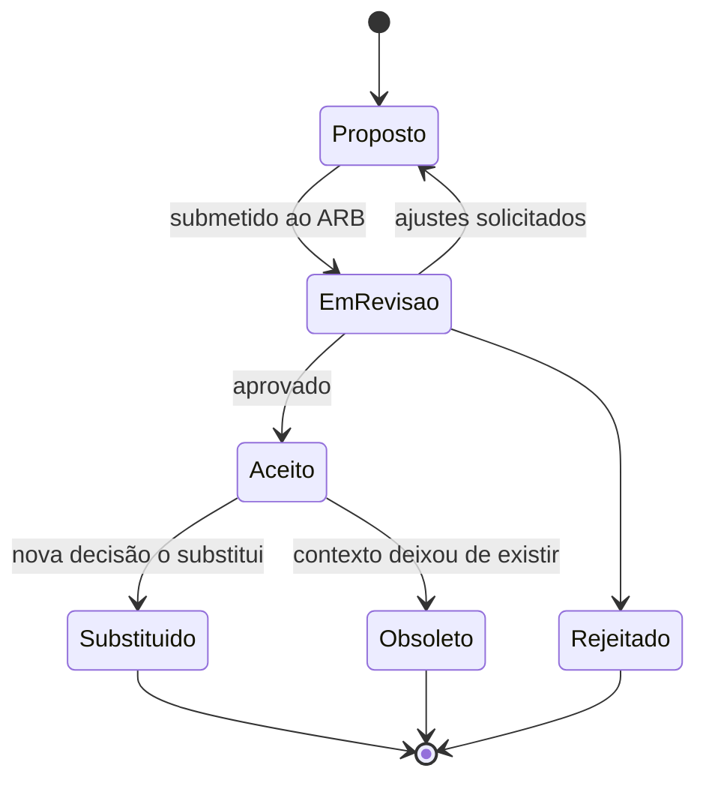

<h1 align="center">🏛️ architecture-decision-records</h1>

  <strong>Modelo pronto de ADR (Architecture Decision Record) e processo de ARB para times de arquitetura corporativa — com exemplos fictícios.</strong>

  
  
  
  

---

## 🎯 O problema

Decisões de arquitetura costumam viver em e-mails, atas e apresentações. Meses depois ninguém lembra **por que** uma tecnologia foi escolhida, quais alternativas foram descartadas e quais riscos foram aceitos — e a mesma discussão recomeça.

## 💡 A solução

Registrar cada decisão relevante como um **ADR curto, versionado e revisável**, e usar um **ARB (Architecture Review Board)** leve para aprová-las no ritmo do negócio.

- **[Modelo de ADR](templates/adr-template.md)** — contexto, opções, decisão, consequências e governança.
- **[Processo de ARB](docs/processo-arb.md)** — quando um ADR é obrigatório, fluxo de revisão e SLAs.
- **[Exemplos](examples/)** — três decisões fictícias de uma "Empresa Exemplo".

## 🗺️ Ciclo de vida de um ADR

## 📚 Exemplos

| ADR | Decisão | Status |
|---|---|---|
| [0001](examples/0001-registrar-decisoes-com-adr.md) | Registrar decisões de arquitetura com ADRs | Aceito |
| [0002](examples/0002-camada-de-integracao-centralizada.md) | Camada de integração centralizada entre CRM, ERP e ITSM | Aceito |
| [0003](examples/0003-pseudonimizar-identificadores-pessoais.md) | Pseudonimizar CPF/CNPJ nas integrações | Aceito |

## 🚀 Como adotar

1. Copie `templates/adr-template.md` para a pasta `docs/adr/` do seu repositório.
2. Numere em sequência (`0001-…`, `0002-…`) e nunca reaproveite números.
3. Abra um *pull request* por ADR: a revisão do PR **é** a revisão do ARB.
4. Ao mudar uma decisão, crie um novo ADR e marque o antigo como *Substituído*.

## 🔗 Relacionados

- [capability-map-template](https://github.com/ncontatori/capability-map-template) — mapa de capacidades e portfólio de aplicações
- [lgpd-pseudonymization-reference](https://github.com/ncontatori/lgpd-pseudonymization-reference) — implementação de referência do ADR 0003

---

Feito por <a href="https://ncontatori.github.io">Nestor Cremm Contatori</a> · <a href="https://linkedin.com/in/nestorcontatori">LinkedIn</a>

