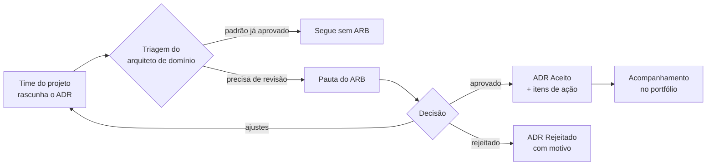

# Processo de ARB (Architecture Review Board)

Um ARB eficaz é **leve, previsível e orientado a risco**: revisa o que importa, rápido o bastante para não virar gargalo.

## Quando um ADR é obrigatório

| Gatilho | Exemplo |
|---|---|
| Nova plataforma, produto SaaS ou fornecedor de tecnologia | Contratar uma ferramenta de CRM |
| Nova integração entre sistemas de domínios diferentes | ERP ↔ plataforma de dados |
| Tratamento novo de dados pessoais ou sensíveis | Exportar dados de alunos para um parceiro |
| Desvio de um padrão ou princípio aprovado | Usar banco de dados fora da lista de referência |
| Custo acima do limite definido pela governança | {{ex.: > R$ X por ano}} |

Mudanças dentro de padrões já aprovados **não** passam pelo ARB.

## Fluxo

## Papéis

- **Proponente** — escreve o ADR e apresenta as opções.
- **Arquiteto de domínio** — faz a triagem e ajuda a lapidar o ADR.
- **ARB** — arquitetura corporativa, segurança, dados, infraestrutura e um representante de negócio.
- **Secretaria** — mantém pauta, registro e prazos.

## SLAs sugeridos

| Etapa | Prazo |
|---|---|
| Triagem | 2 dias úteis |
| Inclusão em pauta | próxima reunião (semanal) |
| Decisão | na reunião; casos complexos em até 2 semanas |

## Indicadores

- % de compras e projetos de tecnologia que passaram pelo ARB
- Tempo médio entre submissão e decisão
- Nº de exceções aprovadas e vencidas
- Aderência aos padrões no portfólio de aplicações
