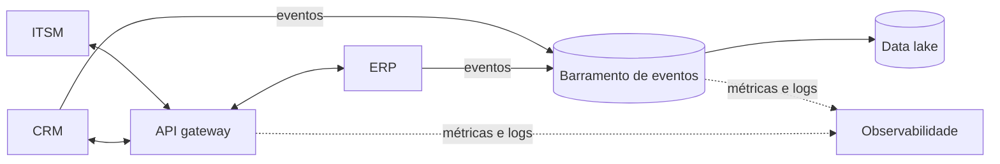

# ADR 0002 — Camada de integração centralizada entre CRM, ERP e ITSM

> Exemplo fictício · Empresa Exemplo S.A.

| Campo | Valor |
|---|---|
| **Status** | Aceito |
| **Data** | 2026-02-20 |
| **Decisores** | Arquitetura corporativa, Engenharia de integração, Segurança |
| **Camada TOGAF** | Aplicação · Tecnologia |

## 1. Contexto

A Empresa Exemplo mantém 40+ integrações ponto a ponto entre CRM, ERP, ITSM e o data lake. Cada nova aquisição adiciona 8–12 integrações, cada uma com autenticação, monitoramento e tratamento de erro próprios. Falhas levam em média 2 dias para serem diagnosticadas.

## 2. Direcionadores

- Reduzir o tempo de integração de empresas adquiridas
- Observabilidade única das integrações
- Segurança e governança de APIs padronizadas

## 3. Opções consideradas

| Opção | Prós | Contras |
|---|---|---|
| A — Manter ponto a ponto | Sem investimento | Complexidade cresce O(n²); sem visão única |
| B — Camada de integração (API gateway + barramento de eventos) | Contratos reutilizáveis; observabilidade central; segurança padronizada | Investimento inicial; novo componente crítico |
| C — iPaaS de mercado | Conectores prontos | Custo por transação; dependência de fornecedor |

## 4. Decisão

Adotar a **opção B**: API gateway para integrações síncronas e barramento de eventos para as assíncronas, com contratos versionados e catálogo de APIs.

## 5. Consequências

**Positivas** — integrações novas reutilizam contratos; diagnóstico centralizado; políticas de segurança únicas.
**Negativas** — a camada vira componente crítico. Mitigação: alta disponibilidade, SLOs e plano de contingência.

## 7. Governança

- **Indicadores:** tempo médio de nova integração; MTTR de falhas de integração; % de integrações no catálogo
- **Itens de ação:** migrar as 10 integrações mais críticas no primeiro semestre
